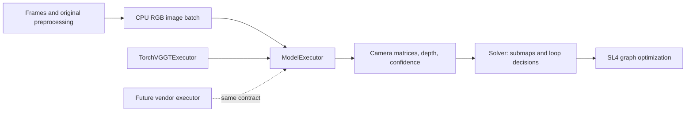

# Edge-VGGT-SLAM execution boundary

The first tested hardware target is RK3588S. The project separates model execution from submap construction and SL4 optimization so another accelerator can implement the same prediction contract. An interface is not evidence that a second NPU, a complete RKNN model, or real-time SLAM already works.

## Model execution

`vggt_slam/model_execution.py` defines the boundary using NumPy and standard-library types. A backend implements `predict` and declares its execution capabilities. It does not need to inherit `torch.nn.Module` or expose `parameters()`.

The request is a C-contiguous CPU float32 RGB array with shape `[S, 3, H, W]`, values in `[0, 1]`, and the original VGGT 14-pixel patch grid. It has already been decoded, rectified when configured, and resized by the input path. An executor must treat these pixels as read-only and preserve image order and geometry. It must not decode the original filenames again or silently change crop, calibration, token resolution or model weights.

The synchronous result contains these CPU float32 arrays:

| Field | Shape | Meaning |
|---|---|---|
| `extrinsic` | `[S, 3, 4]` | World-to-camera matrices in the model batch's coordinate frame |
| `intrinsic` | `[S, 3, 3]` | Camera calibration in the preprocessed image's pixel coordinates |
| `depth` | `[S, H, W, 1]` | Camera-axis Z-depth in the original model's scale, not ray distance or inverse depth |
| `depth_conf` | `[S, H, W]` | Original depth confidence, not assumed to be a probability |

The common boundary checks frame count, shapes, dtype and finite values. It does not convert a projective SL4 map into metric SE3, align predictions to ground truth, rescale depth, or claim that another model is geometrically interchangeable with VGGT. Frame IDs and input timing remain the caller's responsibility; repeating an old prediction is not a fresh observation.

Returned arrays must remain valid after an SDK output buffer is released and during subsequent inference calls. A native adapter owns its packing, device transfers, synchronization and any necessary output copies. Errors propagate; the common interface does not silently switch to CPU. A vendor adapter must also reject unsupported image sizes, batch sizes and request kinds explicitly. Persistent device contexts and their lifetime remain the adapter owner's responsibility.

`TorchVGGTExecutor` adapts the existing original model. It owns Torch device selection, no-gradient execution, the original pose-encoding conversion, removal of the original singleton batch dimension, and conversion to CPU arrays. Legacy callers can still pass their existing model to `Solver.run_predictions`; adaptation occurs at that boundary. This preserves the existing loading and optional subnetwork acceleration paths without presenting them as a complete NPU model.

## SLAM backend

`Solver` consumes decoded camera matrices and dense predictions. It handles submap identity, overlap, scale association, loop decisions, map storage and the existing SL4 graph. Normal predictions and loop-verification predictions use the same execution interface.

Loop verification requires an explicit similarity capability. The request contains the actual stored query image followed by the retrieved image, and asks for `compute_similarity=True`. The result must include a finite `image_match_ratio`; the existing 0.95 decision threshold remains unchanged. Unsupported loop verification fails explicitly. A future NPU backend cannot quietly disable loop closure or substitute a retrieval score for this model comparison.

Submap image storage and SALAD retrieval still use their existing Torch-based interfaces. This change isolates model execution; it does not claim that the entire SLAM dependency stack is Torch-free. Prepared input pixels, frame IDs and query/retrieved ordering must survive both paths unchanged. Submap storage shares the prepared RGB memory: a caller must keep those pixels immutable until that submap is released, not merely until inference returns. A capture-ring buffer must be copied into stable storage before it is retained as a submap.

## Implementation status

The original Torch model adapter is the reference implementation. RK3588S acceleration currently consists of separately measured subnetworks and an optional hybrid mapper. There is no registered all-NPU executor or validated second-vendor backend. Implementing another adapter requires numerical comparisons against the original model, actual device execution evidence, transfer-inclusive timing, resource cleanup, and the same SLAM geometry and loop checks.

The [v21 board regression](results/model_execution_v21.json) exercises the real Solver entrypoint with original FP32 inference and compares the canonical outputs and first SL4 graph to the direct call. A separate original similarity request checks the same adapter path's numerical behavior. This small fixed-pair regression establishes the tested interface's compatibility; it does not establish full trajectory accuracy, natural loop closure or speed improvement. [Synthetic contract and compatibility tests](results/synthetic_tests_v21.json) cover additional rejection and ordering cases without dataset/model inference on the host.

The project name describes this execution boundary and embedded deployment direction. It does not change the outstanding acceptance targets: fresh-observation tracking rate, input-to-pose P95 latency, dense-map cadence, endurance, bounded memory and trajectory/map quality remain separately measurable requirements.

## License boundary

The repository's BSD-2-Clause code license does not grant rights to external model weights, vendor SDKs or third-party implementations. Loading weights through a generic executor, compiling them to RKNN or changing the project name does not remove their applicable terms. See [model licenses](MODEL_LICENSES.md) and [third-party notices](THIRD_PARTY_NOTICES.md).
