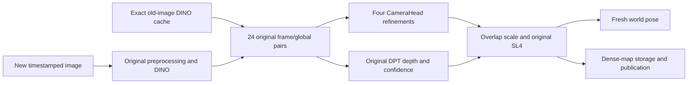

# Real-time feasibility review

Reviewed on 2026-10-13 against public commit `6b3888d232e2feed276e4b35e395dddebbc07303` and the saved v82–v87 board evidence. This is a design review, not a new performance acceptance result.

**Decision: the current execution path has no demonstrated route to 20 Hz fresh poses with input-to-pose P95 at most 100 ms.** Incremental graph/layout improvements remain useful engineering results, but their measured scale does not close the end-to-end gap. Do not commit to an implementation schedule for that target without a substantially better complete-block execution result and a budget for every remaining stage. This conclusion does not prove physical impossibility on the chip.

The scope remains the original pretrained VGGT, all original layers/tokens and original SL4 geometry, entirely on RK3588S. No additional model, traditional pose estimator, interpolation-based pose counting or host GPU is an implementation option. Precision/layout changes need numerical and task-quality validation. Physical-camera testing remains deferred.

## 1. Measured gap and the actual critical path

The [latest complete replay](../results/original_calibrated_camera_v82.json) produced 31 fresh poses in 27.7595 seconds: **1.1167 Hz**, with **1.0688 s** complete P95 latency. The required throughput improvement is **17.91×**. These measurements used a 16 GB board, bounded 1 GHz NPU operation and two-frame `84×112` inputs. They are not measurements at the original larger input resolution.

The same version's fixed-input experiment has 16 pairs. Excluding the first pair leaves the following nonoverlapping warm means; these are service times, not replay P95 values:

| Stage | Warm mean per new observation |
| --- | ---: |
| Original DINO, with the old image already cached | 166.63 ms |
| Original 24 frame/global pairs, excluding DINO | 481.00 ms |
| Original CameraHead, all four refinements | 116.43 ms |
| Original DPT, both frames | 145.63 ms |
| Other prediction/preprocessing/codec work | 37.43 ms |
| SL4, points and complete-service residual | 31.13 ms |
| **Complete service** | **978.26 ms** |

For the current serial executor, 20 fresh observations per second requires average service no greater than 50 ms: a **19.57×** improvement over this warm experiment, with additional headroom needed for variation. Pipelining changes the throughput equation, but still has to meet the complete latency limit and the capacity of the shared NPU. Replicating workers does not make each request shorter.

Two counterfactuals expose why a local optimization is insufficient:

- If the entire aggregator took 10% less time, with other stages unchanged, service would fall only to **930.16 ms**, a **5.17% throughput increase**. A pair00 gain cannot be assumed to apply to every layer.
- Even if DINO and the entire aggregator took zero time, unchanged remaining stages would still take **330.63 ms**. Removing only DPT would leave **832.63 ms**.

These are Amdahl calculations on the measured path, not hardware lower bounds.

The two head branches show data dependencies, not proven concurrent execution on this NPU. The current implementation runs them sequentially.

## 2. Computation that cannot simply be cached or deferred

**DINO reuse is already implemented.** Identical pixels under a fixed model/backend may reuse their independent DINO tokens. Repeating this proposal does not provide a new speedup. See [patch caching](../vggt_slam/patch_cache.py).

**Global attention is not a causal decoder.** Once the companion image changes, the old image's globally contextualized tokens can also change. Reusing those states as a rolling KV cache would change the original computation. Even frame0 reuse needs the same special-token role: a previous pair's second image becomes the next pair's first image, and the original first/other camera/register tokens differ. See the [pinned original aggregator](https://github.com/MIT-SPARK/VGGT_SPARK/blob/6e6e16107b88e8e76c751826af10d4295d87ecd2/vggt/models/aggregator.py) and [retained execution](../vggt_slam/rknn_retained_aggregator.py).

**CameraHead's four refinements are sequential.** Each uses the preceding unactivated prediction as conditioning. Keeping weights and buffers resident or fusing dispatches may help; treating all four iterations as identical or independent is invalid. They currently take longer than the entire 100 ms latency target. See [the original iteration adapter](../vggt_slam/rknn_camera_head.py).

**Map publication frequency and depth-computation frequency are different controls.** `Solver.add_edge` estimates cross-submap scale from both contexts' overlap point clouds and confidence masks, then constructs the SL4 edge. A raw CameraHead pose has the local gauge of its own model call. Reducing DPT to once every 2–5 seconds leaves this original scale connection unresolved for intervening pairs. Reusing the same anchor image does not prove its context-dependent depth remains unchanged. Preserve these dependencies before calling a result a fresh world pose. See [scale construction](../vggt_slam/solver.py) and [the prediction contract](../vggt_slam/model_execution.py).

## 3. The hardware budget is tight; the bottleneck is not just Python

The [source-derived compute count](../deploy/rk3588/validation/original_budget/compute-budget-r2.json) is **93.201 GMAC per fresh observation**, after old-image DINO reuse at `84×112`. At 20 Hz this is **1.864 TMAC/s**, excluding normalization, activations, RoPE, softmax, layout, transfers and SL4. Removing the depth head alone still leaves a pose-prefix count of 82.751 GMAC; that prefix is not an independently validated world-pose path.

As an explicitly optimistic illustration, if every counted MAC benefited from an aggregate 6 TOPS peak, with two operations per MAC, dense arithmetic alone would consume **31.07 ms**, or **62.13%** of that peak at 20 Hz. The active graph mixes FP16 and W8A8; the [advertised RK3588 specification](https://www.rock-chips.com/a/en/products/RK35_Series/2022/0926/1660.html) does not establish achievable throughput for that graph. The calculation is neither a feasibility proof nor an impossibility proof. Three NPU cores share the advertised aggregate capacity.

The [v82 profiles](../deploy/rk3588/validation/original_calibrated_camera/README.md) report 1,218 NPU rows and 13 CPU input/output rows per set of four aggregator groups, with no internal CPU mathematical fallback. Norm, attention and FC1 often have single-core task allocation; QKV and FC2 have three-core allocation. These labels do not measure continuous core utilization or prove all fused arithmetic is integer. The archived v80 normal-run budget for the same retained aggregator records about 428 ms of `rknn_run` wall time per observation; it is separate from the v82 warm table above. This includes runtime/driver submission and waiting; its host/device split remains unmeasured. Optimizing outer Python guards and copies cannot remove the work inside that call.

Logical public SDK input/output payload is about **10.31 MB per warm observation**. This is not physical DDR traffic. Model-file size, loaded weight space, DMA allocation and RSS likewise do not measure bytes read per request. The inspected board exposes no supported physical DDR/stall counter: DFI/DMC are disabled, and the matching-version driver source disables RK3588 bandwidth-counter support. SDK cycle/RW annotations are not a substitute for verified hardware counters. See the official [driver configuration](https://github.com/rockchip-linux/kernel/blob/41e9ffebc838e020f0bf842123d55108a7363fe7/drivers/rknpu/rknpu_drv.c) and [counter getters](https://github.com/rockchip-linux/kernel/blob/41e9ffebc838e020f0bf842123d55108a7363fe7/drivers/rknpu/rknpu_job.c).

A complete custom NPU executor is not a ready alternative: the frozen [SDK custom-op interface](https://github.com/airockchip/rknn-toolkit2/blob/v2.3.2/rknpu2/runtime/Linux/librknn_api/include/rknn_custom_op.h) exposes CPU/GPU targets, not a general user NPU-kernel target. Native MatMul access alone does not provide NPU LayerNorm, RoPE and softmax fusion. Confirm a usable backend interface before proposing a full rewrite.

## 4. Long-run memory and publication need an architectural fix

**The present map store grows without a capacity policy.** `Solver.run_predictions` retains each pair's FP32 images in `Submap.frames`; `GraphMap.submaps` retains every submap. At 20 Hz for 30 minutes there would be 36,000 pairs. At the current resolution, image storage alone is:

`36,000 × 2 × 3 × 84 × 112 × 4 = 8,128,512,000 bytes = 7.5703 GiB`.

This is a source-derived logical payload under the current allocation policy, not a measured 30-minute RSS. It excludes points, colors, confidence, graph state, model/runtime memory and the OS. The short-run 3,380 MiB peak therefore cannot substantiate an 8 GB deployment claim. See [image retention](../vggt_slam/submap.py), [submap ownership](../vggt_slam/map.py) and [pair construction](../vggt_slam/solver.py).

**Every update currently rebuilds growing outputs.** The [replay loop](../scripts/replay_original_vggt.py) traverses all submaps, serializes all graph nodes and rewrites the trajectory. It also invokes [full-graph Levenberg–Marquardt](../vggt_slam/graph.py) on every update. A bounded input queue does not bound these costs or resident history.

The appropriate storage/scheduling design is an active overlap working set, exact immutable historical chunks in backing storage, a bounded publication queue, and a small fresh-pose message separated from dense-map export. Publish map revisions every 2–5 seconds and retain coordinate-frame/revision identity. This must not remove the depth/confidence needed for the next original scale edge. Check that backing-store bandwidth, failures and capacity are handled; lowering export frequency alone does not free retained arrays.

There is also a narrow exact-math opportunity: with `max_loops=0`, the current graph is a connected tree with one prior. In exact arithmetic, composing each original SL4 edge from that prior satisfies every factor at zero residual. An incremental solution could avoid repeatedly solving the same consistent tree. It is **not implemented or numerically validated**. It must use the actual SL4 group operations and be compared against the current solver, including long-chain drift. Cycles, another prior, external changes to old values or auto-calibration invalidate this shortcut; retain a general solve path for those cases.

## 5. Which experiments should continue

| Route | Evidence | Decision |
| --- | --- | --- |
| Exact QKV projection/layout partition | v87 pair00: 17.258→15.484 ms, 10.28% lower; full FP32 outputs match on two inputs | Preserve as a component result. Do not extrapolate to whole-model real time. |
| More workers / duplicated contexts | Offline throughput improved; three-worker live replay failed before any fresh pose; two-worker P95 about 2.36 s | Do not use as the 100 ms solution. |
| Current onboard GPU bridges | Complete MLP route slower; stable attention bridge slower; another bridge unstable | Stop expansion without a new causal explanation and complete-boundary evidence. |
| DPT uniformly W8A8 | About 19.37% slower than the original FP16 route | Keep the measured FP16 path. |
| DINO uniformly W8A8 | Earlier rotation-RPE degradation about 34.5% | Do not adopt under the existing quality budget. |
| More outer-copy / guard changes | SDK `rknn_run` dominates measured aggregator time; its host/device split remains unmeasured | First measure the removable host contribution; do not assume an order-of-magnitude benefit. |
| General native NPU executor | No established interface for a full custom original block; no competitive complete-block result | Do not start a full rewrite on bare-MatMul results. |
| Bounded storage and incremental publication | Direct source-level growth problem | Necessary for long-run acceptance, independent of inference acceleration. |

The v87 five-pair group0 rewrite finished its CPU-ORT numerical gate while this review began: all four outputs on two real inputs passed `rtol=1e-4, atol=1e-5` and were byte-identical to the original group0 ONNX. It has **not** been RKNN-compiled, timed or adopted. Group0 ONNX equivalence does not establish quantized accuracy or speed. Pair00 quantized outputs remain different from FP32 and fail the strict tensor comparison.

Quality is also an open gate. In the v82 fixed 17-image evaluation, rotation RPE RMSE increased 7.30% against the original CPU reference, while the worst interval reached 27.24 degrees. All 80 strict FP32 output comparisons failed. The saved aggregate depth/confidence relative-L2 errors were about 5.26%/42.91%; finite map points do not establish map accuracy. These results warrant explicit confidence/filtering and trajectory-tail checks on held-out sequences, rather than acceptance based only on an average ATE.

## 6. A bounded plan with explicit decision gates

1. **Attribute the existing whole-path cost once, without another compilation.** On the existing original model and real inputs, retain normal flags0 timing and measure wall time plus thread/process CPU time around each of the 16 SDK invocations per warm pair. Query supported inference-duration diagnostics outside the service timer; separately sample existing per-core load/frequency. Preserve output checks and complete buffer/context accounting. This is a single decision measurement, not another open-ended profiling campaign. It can distinguish host work from device waiting; it cannot diagnose DDR saturation by itself. If waiting dominates, stop further outer-wrapper micro-optimization as a route to 20 Hz.
2. **Require an end-to-end budget before expanding a kernel experiment.** Use the attribution above to select one complete original computational block with a plausible gain large enough to matter. Include projection, normalization, RoPE, attention, MLP, synchronization and output ownership. A hypothetical 25 ms allocation for all 24 aggregator pairs would leave only about 1.04 ms per pair; the latest pair result is 15.48 ms. That allocation is illustrative, not a measured achievable schedule. Confirm a supported execution interface and a budget for DINO, CameraHead, DPT and SL4 as well. If no candidate can close that budget, report that 20 Hz is not presently deliverable under the fixed constraints and stop using percentage-level gains as its implementation plan.
3. **Fix growing state and output work while preserving geometry.** Introduce bounded active data, exact historical backing storage and revisioned incremental pose/map publication. Validate the no-loop SL4 tree shortcut independently before adopting it. These changes address 30-minute operation; they do not supply the missing inference speedup.
4. **Validate the complete candidate on real sequences before acceptance.** Use original CPU references on identical selected frames for numerical/trajectory comparisons, and separately evaluate the actual timestamp-paced replay's selected frames. Include motion, low texture and lighting changes, trajectory failure/recovery and map quality. The current 17-frame result does not generalize, and a 112-wide comparison does not quantify resolution loss against a larger-resolution reference.
5. **Only then run the duration and deployment gates.** Measure the same configuration for 30 minutes with fresh observations, complete P95, publication gaps, queue age/drops, map cadence, graph growth, RSS/PSS plus device allocations, temperatures and cleanup. Physical 8 GB hardware remains a separate validation. Loop closure is currently unsupported; a run with `max_loops=0` cannot satisfy the nonblocking-loop part of the goal. Any loop retrieval/verification work must stay within the original VGGT's own features and geometry and prove both detection quality and foreground latency under contention.

The existing 1 GHz tests are bounded to 180 seconds. Repeated short runs or restarts do not establish 30-minute continuous operation; the sustained thermal/clock test conditions must be settled before that experiment.

## Evidence boundaries

This review inspected source, saved actual-board outputs and primary upstream/SDK documentation. It introduced no model, kernel, driver, clock or runtime change. The already-running group0 FP32 gate completed normally; no subsequent group0 compile or performance run was launched. The main README remains English.

Useful immutable receipts, identified by SHA256:

| Saved receipt | SHA256 |
| --- | --- |
| v82 complete fixed-input run | `8c5a6dce8769cc04dc6febded44d3c3f25ae726f9e03f8a8f3034a29e4e27e94` |
| v82 complete timestamp replay | `e4356e0c6ee07d5ed29e3bf8b63d1087810afaa196bb9f9aeee4eb568b2fcc2b` |
| Original source-derived compute count | `ffc32399cf1186d6d4c00c1b0481ccde7998fabc633df1a1ac3aec072b88cc70` |
| v87 pair00 normal component run | `a99de3e9aa1f38a2a724a684e1bfc8bbfc68446177af0938a2e97ae822965b79` |
| v87 group0 FP32 gate | `d22dcc44573211af2931ceb25abf1f36a60a2cb0f24da56c2056dba98402686d` |

Raw images, captured arrays and weight-bearing model artifacts remain outside the public repository. [Code, original source, weights and SDK licenses remain separate](../MODEL_LICENSES.md).
